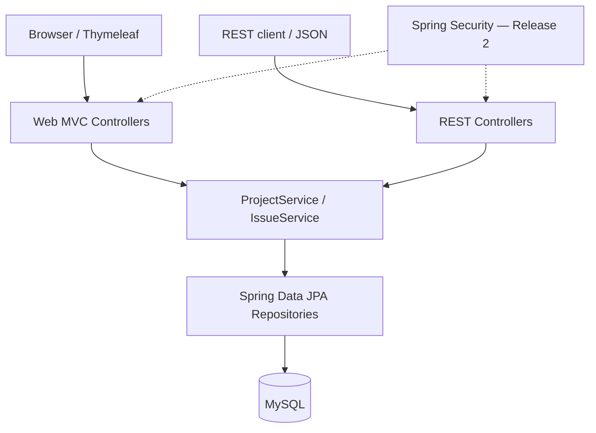
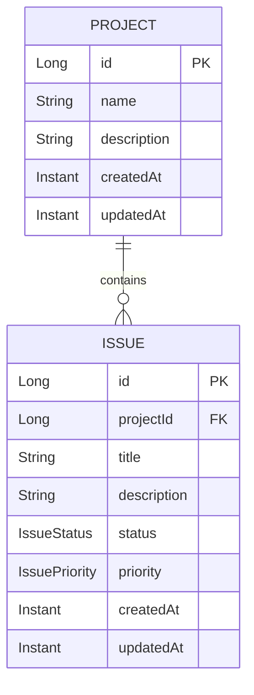

# 03 — Architecture, Data Model, and API Sketch

**Status:** Design sketch aligned to [accepted ADR-0001](decisions/0001-initial-scope.md); application code does not exist yet. Unspecified implementation details remain open.

For implemented package, DTO, validation and API error conventions, see [SET-03 application conventions](07-application-conventions.md). Feature models below remain illustrative where superseded by accepted ADRs.

## Agreed technical direction



- `controller.web`: server-rendered HTML controller methods.
- `controller.api`: JSON endpoints and HTTP status handling.
- `service`: validation beyond simple field rules, project/issue business operations, authorization later.
- `repository`: `JpaRepository` access to entities.
- `entity`: JPA mappings and persistence fields.
- `dto`: inputs and responses, separate from JPA entity objects.
- `templates`: Thymeleaf views.
- `config` / `security`: database/app config and, later, auth.

Use one Spring Boot application and one MySQL database. Do **not** split into microservices.

- **Base Java package:** `ca.humanbeans.sourbeans` (e.g., `ca.humanbeans.sourbeans.controller.api`, `.service`, `.repository`, `.entity`).
- **Local database:** Each developer installs MySQL locally, rather than using a container or a shared database server. See [local development setup](06-local-development.md).
- **Spring configuration:** Supply database URL, username, and password outside source control. Exact Java/Spring/MySQL versions and schema migration approach remain to be selected together.

## Release 1 data model



**Rules:**

- An issue belongs to exactly one project; project can have zero or many issues.
- Project ID and Issue ID are server-generated.
- Status: `OPEN`, `IN_PROGRESS`, `CLOSED`.
- Priority: `LOW`, `MEDIUM`, `HIGH`.
- Creation/update timestamps are server-managed.
- Deleting a project with issues is rejected (rather than silently cascading and losing issues).
- Avoid serializing JPA entities directly from controllers; map to DTOs to prevent accidental exposure/circular references.

### Release 2 model additions

- `User`: `id`, `email` (unique), `passwordHash`, optional display name.
- `ProjectMembership`: `id`, `projectId`, `userId`, `role` (`OWNER` or `MEMBER`); enforce uniqueness for `(projectId, userId)`.
- At least one owner per project; define project-creation ownership during security implementation.

## REST API sketch (agreed prefix; routes pending implementation)

**Approved base path:** `/api`. The specific resource routes below are initial design proposals. A different prefix would require updating the accepted decision.

| HTTP   | Path                               | Meaning                                                      | Expected success |
| ------ | ---------------------------------- | ------------------------------------------------------------ | ---------------- |
| GET    | `/api/projects`                    | List projects                                                | 200              |
| POST   | `/api/projects`                    | Create project                                               | 201 + `Location` |
| GET    | `/api/projects/{projectId}`        | Get project                                                  | 200              |
| PUT    | `/api/projects/{projectId}`        | Update project                                               | 200              |
| DELETE | `/api/projects/{projectId}`        | Delete **empty** project                                     | 204              |
| GET    | `/api/projects/{projectId}/issues` | List issues; optional `status` / `priority` query parameters | 200              |
| POST   | `/api/projects/{projectId}/issues` | Create issue                                                 | 201 + `Location` |
| GET    | `/api/issues/{issueId}`            | Get issue                                                    | 200              |
| PUT    | `/api/issues/{issueId}`            | Update issue                                                 | 200              |
| DELETE | `/api/issues/{issueId}`            | Delete issue                                                 | 204              |

### Example JSON

**Create a project —** `POST /api/projects`

```json
{ "name": "Class Project", "description": "Issues for our practice app" }
```

**Create an issue —** `POST /api/projects/1/issues`

```json
{
    "title": "Add issue filters",
    "description": "Filter by status and priority",
    "priority": "MEDIUM"
}
```

**Issue response example** (illustrative IDs/dates):

```json
{
    "id": 12,
    "projectId": 1,
    "title": "Add issue filters",
    "description": "Filter by status and priority",
    "status": "OPEN",
    "priority": "MEDIUM",
    "createdAt": "2026-10-29T18:00:00Z",
    "updatedAt": "2026-10-29T18:00:00Z"
}
```

### Error behavior

- **Agreed format:** API failures return RFC 9457 Problem Details, normally with `Content-Type: application/problem+json`. Use the standard `type`, `title`, `status`, `detail`, and (when useful) `instance` members. Any extra field-validation members require an explicit, documented choice during implementation.
- `400 Bad Request`: invalid form/JSON, enum, or field constraints.
- `404 Not Found`: project or issue ID doesn't exist.
- `409 Conflict`: attempting to delete a project with issues.
- Release 2: `401 Unauthorized` when not authenticated; `403 Forbidden` (or intentionally hidden `404`) for disallowed access. Decide one policy and apply consistently.

Example RFC 9457 validation response (illustrative; no custom extensions required yet):

```json
{
    "type": "about:blank",
    "title": "Bad Request",
    "status": 400,
    "detail": "The issue title must contain 5–120 characters.",
    "instance": "/api/projects/1/issues"
}
```

For a missing resource or a conflict, use the same Problem Details structure with the corresponding HTTP status (404 or 409). Browser form validation can display field-specific messages without returning JSON.

## Thymeleaf route sketch (not a fixed contract)

| URL                                    | Page/action                 |
| -------------------------------------- | --------------------------- |
| `GET /projects`                        | Project list                |
| `GET /projects/new`                    | New project form            |
| `GET /projects/{projectId}`            | Project detail + issue list |
| `GET /projects/{projectId}/issues/new` | New issue form              |
| `GET /issues/{issueId}`                | Issue details               |
| `GET /issues/{issueId}/edit`           | Edit issue form             |

Form POST routes are implementation decisions; generally follow Post/Redirect/Get after successful mutations.

## Security design boundary (Release 2)

- Browser/Thymeleaf: Spring Security form login backed by session cookies, CSRF protection for state-changing form requests.
- API: Bearer JWT authentication, configured statelessly for API requests.
- Use the same account and membership authorization rules for both paths via services/security checks.
- Passwords use Spring Security's password encoder; never store plaintext.
- Signing keys, database credentials and any other secrets are supplied through environment/configuration, never committed.
- Do not rely on hidden buttons or UI checks for authorization: validate project access on the server.

## Deployment sketch (Release 2)

1. Prepare an Ubuntu VM with supported Java runtime and MySQL connectivity.
2. Set environment variables/secrets and a production Spring profile.
3. Build the app and run it as a managed process/service.
4. Expose it only through approved network/firewall configuration; use HTTPS if network-accessible.
5. Restart and verify that data persists and authorization still works.

## Remaining implementation choices

ADR-0001 has already settled the package name, **local MySQL installation**, **`/api` prefix**, and **RFC 9457** error format. The following are still undecided:

- Exact Java, Spring Boot, and compatible MySQL versions, consistent with course instruction.
- Whether to use shared example seed data and how to distribute it safely.
- Local schema management and a safe migration mechanism before deployment.
- Any additional Problem Details extension members for field-level validation.
- Final endpoint payloads and web form routes, which are sketched above but not yet implemented.
